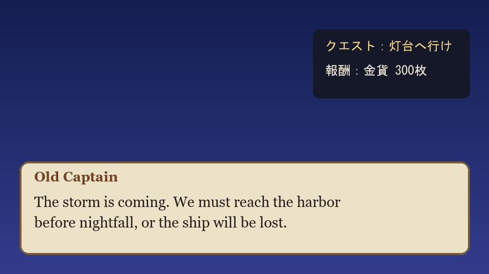
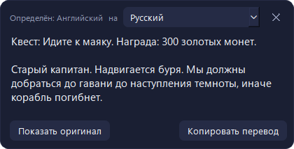
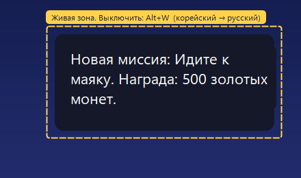

<p align="center"></p>

<h1 align="center">ScreenLingo</h1>

<p align="center">Переводит любой текст на экране прямо поверх оригинала: игры, программы, видео, картинки.<br>
Выделили область, и через секунду там уже русский текст.</p>

<p align="center"></p>

## Что умеет

- **Перевод поверх оригинала.** Перевод ложится на место исходного текста, а цвет плашки берётся с фона, поэтому всё выглядит как родной интерфейс. Зажмите перевод мышкой, и снова появится оригинал.
- **Язык определяется сам.** Выберите только язык, на который переводить. Английский, японский, китайский, корейский, русский, греческий, тайский, арабский, хинди распознаются автоматически. Переводить можно между 130+ языками в любую сторону.
- **Живая зона.** Закрепите область (субтитры, окно диалога, чат), и перевод будет обновляться сам, как только там меняется текст. Окно перевода пропускает клики сквозь себя и не мешает играть.
- **Работает из любой программы.** Горячие клавиши глобальные, программа живёт в трее.
- **Приватность.** Скриншоты не покидают компьютер: текст распознаётся локально (RapidOCR), в интернет уходит только сам текст для перевода.

| Режим «Снимок» | Живая зона |
|---|---|
|  |  |

## Как пользоваться

| Клавиши | Что делает |
|---|---|
| `Alt+Q` | Выделить область и перевести |
| `Alt+W` | Включить или выключить живую зону |
| `Esc` | Закрыть перевод |
| Зажать перевод мышкой | Показать оригинал |

Клавиши, язык перевода, вид живой зоны (поверх текста или субтитрами) и автозапуск меняются в настройках (правый клик по значку в трее).

## Установка

1. Скачайте `ScreenLingo-win64.zip` со страницы [Releases](../../releases).
2. Распакуйте и запустите `ScreenLingo.exe`. Значок появится рядом с часами.
3. При первом запуске программа скачает модели распознавания (около 30 МБ).

Нужна Windows 10 (2004+) или 11 и интернет для перевода.

> Игры в режиме «полный экран (эксклюзивный)» не дают рисовать поверх себя. Переключите игру в «оконный» или «оконный без рамки» режим.

## Запуск из исходников

```bash
py -3.14 -m venv .venv
.venv\Scripts\pip install -r requirements.txt
.venv\Scripts\python main.py
```

Тесты: `.venv\Scripts\python -m pytest`. Сборка .exe: `.venv\Scripts\pyinstaller --noconfirm ScreenLingo.spec`.

## Как устроено

```
Alt+Q ─► снимок экрана ─► RapidOCR (локально) ─► склейка слов в строки и абзацы
                                                        │
          оверлей поверх оригинала ◄─ перевод (Google, запасной MyMemory, кэш)
```

- `screenlingo/ocr.py`: поиск строк, многоязычная модель PP-OCRv6 и дораспознавание «трудных» строк моделями нужной письменности.
- `screenlingo/translate.py`: перевод одним запросом, автоопределение языка, запасной переводчик, кэш.
- `screenlingo/change.py`: живая зона замечает изменение текста и ждёт, пока он успокоится, чтобы не тратить запросы на анимацию.
- `screenlingo/ui/`: выделение области, оверлей, панель, живая зона, трей и настройки (PySide6).
- Окна перевода скрыты от снимков экрана (`SetWindowDisplayAffinity`), поэтому живая зона не переводит сама себя.

## Лицензия

MIT
